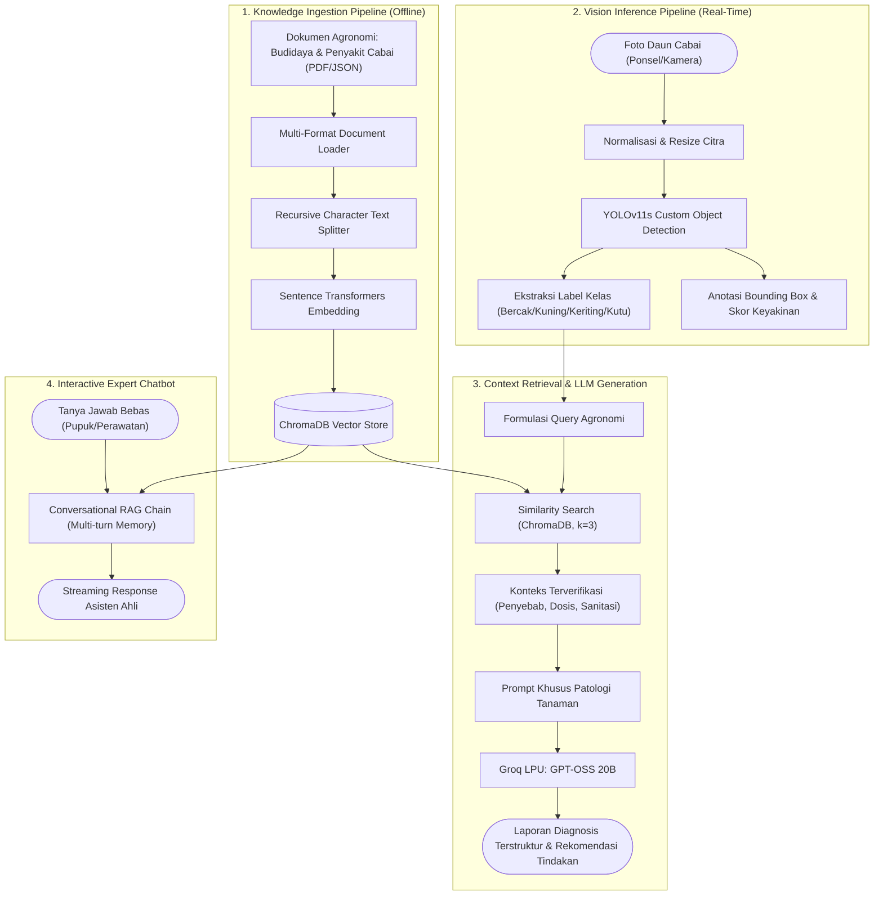

# ChiliCare AI: Diagnosis Penyakit Daun Cabai (YOLOv11s & LLM RAG)

[](https://python.org)
[-00FFFF.svg?logo=ultralytics)](https://github.com/ultralytics/ultralytics)
[](https://fastapi.tiangolo.com)
[](https://langchain.com)
[](https://trychroma.com)
[](https://groq.com)
[](https://docker.com)
[](.github/workflows/ci-cd.yml)
[](https://huggingface.co/spaces/feryms/chilicareAI)

ChiliCare AI adalah aplikasi web untuk mendiagnosis penyakit daun tanaman cabai. Sistem ini menggabungkan deteksi objek YOLOv11s untuk melokalisasi gejala visual pada daun dan Retrieval-Augmented Generation (RAG) untuk memberikan panduan penanganan serta dosis bahan aktif berdasarkan literatur agronomi.

---

## Latar Belakang & Masalah

Penyakit daun dan hama seperti virus gemini, bercak daun cercospora, dan kutu kebul sering menyebabkan penurunan produksi cabai (*Capsicum annuum*). Di lapangan, petani kerap menghadapi kendala:

1. Kesalahan diagnosis antara infeksi jamur dan hama pengisap yang berujung pada penggunaan pestisida yang tidak tepat sasaran.
2. Keterbatasan waktu dan wilayah jangkauan tenaga penyuluh pertanian.
3. Penggunaan bahan aktif tanpa dosis terukur yang memicu resistensi patogen.

ChiliCare AI menyediakan identifikasi visual berbasis foto daun cabai langsung dari peramban ponsel atau desktop, dilengkapi rekomendasi penanganan kuratif dan preventif dari basis data agronomi.

---

## Arsitektur Sistem

Sistem beroperasi melalui dua pipeline terpisah yang terintegrasi di backend FastAPI:



---

## Hasil Evaluasi Model (YOLOv11s)

Model dievaluasi menggunakan data uji independen (*test split*) dengan augmentasi pengujian (*Test-Time Augmentation*).

### Spesifikasi Model
- Arsitektur: YOLO11s (100 layers, 9,414,735 parameters, 21.4 GFLOPs)
- Perangkat Evaluasi: Tesla T4 GPU (16 GB VRAM)
- Kecepatan Inferensi: ~31.7 ms per citra (GPU) / ~180 ms (CPU)
- Ukuran File Bobot: ~19.2 MB (`best.pt`)

### 1. Performa Keseluruhan

| Dataset Split | Gambar | Objek (Instances) | Precision (Box-P) | Recall (R) | mAP@0.5 | mAP@0.5:0.95 |
| :--- | :---: | :---: | :---: | :---: | :---: | :---: |
| Validation | 60 | 110 | 0.861 | 0.789 | 0.869 | 0.713 |
| Test (Final) | 60 | 111 | 0.896 | 0.882 | 0.903 | 0.758 |

### 2. Performa Deteksi per Kelas (Test Set)

| Kelas | Gambar | Objek (Instances) | Precision | Recall | mAP@0.5 | mAP@0.5:0.95 |
| :--- | :---: | :---: | :---: | :---: | :---: | :---: |
| Bercak Daun (Cercospora) | 11 | 11 | 0.963 | 0.909 | 0.905 | 0.797 |
| Daun Keriting (Thrips / Mites) | 11 | 36 | 0.785 | 0.889 | 0.896 | 0.673 |
| Penyakit Kuning (Virus Gemini) | 14 | 16 | 0.898 | 1.000 | 0.995 | 0.825 |
| Daun Sehat (Normal) | 13 | 29 | 1.000 | 0.716 | 0.867 | 0.773 |
| Kutu Kebul (Whitefly) | 12 | 19 | 0.832 | 0.895 | 0.850 | 0.724 |
| Rata-rata (All Classes) | 60 | 111 | 0.896 | 0.882 | 0.903 | 0.758 |

Model mencatatkan recall 1.000 dan mAP@0.5 0.995 pada kelas penyakit kuning, menandakan seluruh sampel uji terdeteksi. Pada kelas bercak daun dan daun sehat, presisi mencapai 0.963 dan 1.000.

---

## Fitur Utama

- **Deteksi lesi visual**: Model YOLOv11s mengidentifikasi bercak daun, daun keriting, daun kuning, daun sehat, dan kutu kebul dengan anotasi bounding box dan skor keyakinan.
- **Rekomendasi penanganan via RAG**: Konteks agronomi diambil dari basis pengetahuan lokal untuk menghasilkan panduan penanganan kuratif, sanitasi, dan takaran bahan aktif.
- **Konsultasi interaktif**: Antarmuka chat mendukung percakapan multi-turn untuk menanyakan perawatan tanaman, pemupukan, dan pengendalian hama dengan respon streaming token via Groq LPU.
- **Efisiensi & proteksi DoS**: RAG chain diinisialisasi sekali saat server startup (singleton lifespan) dan endpoint dibatasi frekuensi request-nya (slowapi limiter).
- **Basis pengetahuan terlabel**: 131 chunk dari 3 PDF agronomi, 3 halaman web, dan `data.json`, masing-masing diberi metadata `label` (Bercak, Keriting, Kuning, Sehat, Whitefly, Umum) sehingga pencarian per-penyakit menjangkau seluruh isi dokumen, bukan hanya entri JSON.
- **Otomatisasi CI/CD**: Rangkaian 40 unit test pytest, regression test sanitasi frontend, linting dengan Ruff, pembuatan Docker image, dan deployment otomatis ke Hugging Face Space melalui GitHub Actions.

---

## Struktur Proyek

```text
chilicareAI/
├── backend/
│   └── api.py                    # Aplikasi FastAPI, routing inferensi YOLO & streaming chat
├── frontend/
│   ├── index.html                # Halaman beranda (Landing page)
│   ├── app.html                  # Antarmuka aplikasi web deteksi penyakit & chat AI
│   ├── script.js                 # Logika streaming chat, upload & markdown parsing
│   ├── background.jpg            # Aset fotografi cabai di kebun
│   └── _redirects                # Konfigurasi routing Netlify CDN
├── src/
│   ├── config.py                 # Konfigurasi variabel lingkungan & path terpusat
│   ├── chains/
│   │   ├── chain.py              # Orkestrasi RAG chain LangChain
│   │   ├── prompt.py             # Prompt engineering agronomi & patologi
│   │   └── rag.py                # Pipeline sintesis diagnosis visi ke teks
│   ├── ingestion/
│   │   ├── loader.py             # Multi-format document loader (web, PDF, JSON, CSV)
│   │   ├── labeler.py            # Penandaan otomatis label penyakit per chunk
│   │   ├── chunker.py            # Pemotongan teks dokumen
│   │   └── embedder.py           # Inisialisasi model embedding
│   └── retrieval/
│       ├── vector_store.py       # Abstraksi database vektor ChromaDB
│       ├── retriever.py          # Konfigurasi retriever dokumen
│       └── reranker.py           # Reranker cross-encoder pendukung
├── data/
│   ├── data.json                 # Basis pengetahuan terstruktur gejala & penanganan
│   └── *.pdf                     # Modul referensi teknis budidaya cabai
├── model/
│   └── best(v11s).pt             # Bobot model YOLOv11s hasil pelatihan
├── tests/
│   ├── test_api.py               # Unit test REST endpoints FastAPI
│   ├── test_chunker.py           # Pengujian pemotongan teks
│   ├── test_config.py            # Validasi konfigurasi & environment
│   ├── test_embedder.py          # Pengujian model embedding
│   ├── test_ingest.py            # Filter noise & strategi retry ingest
│   ├── test_labeler.py           # Penandaan label chunk knowledge base
│   ├── test_prompt.py            # Verifikasi prompt template
│   └── test_reranker.py          # Pengujian fungsionalitas reranker
├── .github/workflows/
│   └── ci-cd.yml                 # CI/CD otomatis (Lint, Test, Docker, Deploy HF)
├── app.py                        # Antarmuka alternatif berbasis Streamlit
├── Dockerfile                    # Konfigurasi kontainerisasi produksi
├── pytest.ini                    # Konfigurasi pytest & pytest-asyncio
└── requirements.txt              # Daftar dependensi produksi Python
```

---

## Panduan Memulai Cepat

### 1. Kloning Repositori & Persiapan Lingkungan

```bash
# Kloning repositori
git clone https://github.com/FeriMauliandi/Chilicare-AI_Chili-Leaf-Disease-Detection.git
cd Chilicare-AI_Chili-Leaf-Disease-Detection

# Buat virtual environment Python
python -m venv .venv

# Aktivasi environment (Windows PowerShell)
.venv\Scripts\activate

# Aktivasi environment (Linux/macOS)
# source .venv/bin/activate

# Pasang dependensi
pip install --upgrade pip
pip install -r requirements.txt
```

### 2. Konfigurasi Variabel Lingkungan (`.env`)

Buat berkas `.env` di direktori utama:

```env
# API Key untuk LLM (Pilih salah satu atau keduanya)
GROQ_API_KEY=gsk_...
OPENROUTER_API_KEY=sk-or-...

# Opsional: Konfigurasi nama model LLM
LLM_MODEL=openai/gpt-oss-20b

# CORS: daftar origin dipisah koma (default: localhost + HF Space)
CORS_ALLOW_ORIGINS=
CORS_ALLOW_ORIGIN_REGEX=^https://([a-z0-9-]+\.)*(netlify\.app|hf\.space)$
CORS_ALLOW_CREDENTIALS=false
```

### 3. Bangun Ulang Basis Pengetahuan (jalankan jika data berubah)

```bash
python ingest.py
```

Perintah ini bersifat **idempoten**: embedding dihitung lebih dulu, baru
koleksi lama dihapus dan dibangun ulang dari 3 PDF, 3 halaman web, dan
`data/data.json`. Jadi jika kuota API habis di tengah proses, basis
pengetahuan lama tetap utuh. Setiap chunk diberi label penyakit secara
otomatis, dan chunk navigasi/daftar isi dibuang. Proses ini membutuhkan
`GOOGLE_API_KEY` (Gemini) dan berjalan sekitar 2 menit karena kuota embedding
free tier dibatasi 100 teks/menit.

Komposisi basis pengetahuan saat ini:

| Label | Chunk |
| :--- | ---: |
| Sehat | 68 |
| Umum | 26 |
| Keriting | 13 |
| Kuning | 10 |
| Whitefly | 8 |
| Bercak | 6 |
| **Total** | **131** |

> Angka dapat bergeser sedikit antar-*run* karena tiga sumber berupa halaman
> web yang isinya bisa berubah.

### 4. Menjalankan Aplikasi

#### Opsi A: Menjalankan Server FastAPI (Direkomendasikan)
```bash
uvicorn backend.api:app --host 0.0.0.0 --port 8000 --reload
```
Akses di peramban:
- Landing Page: `http://localhost:8000/`
- Aplikasi Deteksi & Chat: `http://localhost:8000/app`
- Dokumentasi API Swagger: `http://localhost:8000/docs`

#### Opsi B: Menggunakan Docker
```bash
docker build -t chilicare-app .
docker run -p 7860:7860 --env-file .env chilicare-app
```
Akses aplikasi di `http://localhost:7860`.

---

## Pengujian & CI/CD Pipeline

Proyek ini menerapkan pengujian otomatis terstandar untuk memverifikasi fungsionalitas sistem:

```bash
# Menjalankan seluruh pengujian unit
pytest -v

# Menjalankan pengujian dengan laporan cakupan kode (coverage)
pytest --cov=src --cov=backend tests/

# Menjalankan linter kode
ruff check src/ backend/ tests/

# Menguji sanitasi HTML frontend (butuh Node.js)
node tests/frontend/sanitizer.test.js
```

### Alur Kerja GitHub Actions (`.github/workflows/ci-cd.yml`)
Setiap kali terjadi `push` atau `pull request` ke branch `main`:
1. **Lint & Test:** Memverifikasi kualitas kode dengan `ruff`, mengeksekusi 40 unit test dengan `pytest`, serta regression test sanitasi HTML frontend.
2. **Docker Build:** Menguji build image Docker agar terbebas dari kendala dependensi.
3. **Auto-Deploy:** Mempublikasikan image ke GitHub Container Registry (GHCR) dan memperbarui aplikasi di Hugging Face Space.

---

## Lisensi & Pernyataan Penelitian

Proyek ini dikembangkan untuk tujuan penelitian dan alat bantu agronomi terbuka. Rekomendasi penanganan dan bahan aktif bersumber dari modul penyuluhan budidaya cabai. Selalu perhatikan petunjuk pada label resmi produsen bahan aktif saat melakukan penanganan di lahan pertanian.
